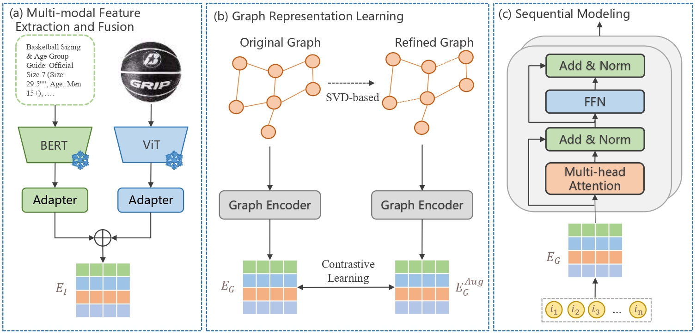

# MGSRec

This is the official PyTorch implementation for the [paper]:
> Empowering Multi-modal Sequential Recommendation with Semantically-enhanced Item Transition Graph.

---

## Overview

While multi-modal sequential recommendation has achieved significant success, existing methods typically rely on powerful sequential encoders, such as Transformers, to capture dynamic interests within a user's history. However, this paradigm is confined to modeling local, intra-sequence dependencies, causing it to overlook rich global collaborative signals. This neglect results in suboptimal item representations learned from purely local contexts, limiting the model's ability to capture the full breadth of user interests. To bridge this gap, we propose **MGSRec**, a framework that integrates global structural information into sequential recommendation by refining a global graph. It first constructs a semantically-enhanced item transition graph, fusing behavioral co-occurrences with multi-modal semantics to overcome data sparsity. Subsequently, a novel, parameter-efficient SVD-based graph contrastive learning strategy denoises the structure while learning task-aligned representations. Finally, MGSRec employs a simple "direct input" paradigm: representations learned from the graph via a graph neural network are directly used as the initial input for the sequential encoder. This design allows the model to capture user dynamics within a pre-enriched, globally-aware representation space. Extensive experiments on three public datasets demonstrate that MGSRec significantly outperforms state-of-the-art methods.



## Requirements

```
recbole>=1.2.0
python>=3.8
torch>=1.13.0
```

## Quick Start

```
python run_baseline.py -m MGSRec -d beauty
```

### Customized Datasets

Please refer to [[link]](dataset#dataset-preprocessing) for details of data preprocessing. Then you can correspondingly try your customized datasets.

### Acknowledgement

The implementation is based on the open-source recommendation library [UniSRec](https://github.com/RUCAIBox/UniSRec).
